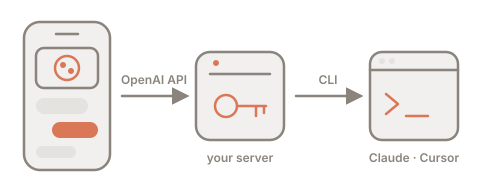

<!-- markdownlint-disable MD033 MD041 -->

# claude-max-to-api

<!-- markdownlint-enable MD033 MD041 -->

claude-max-to-api turns your Claude Pro or Max subscription into a private,
OpenAI-compatible API for your own apps. Anything that can talk to an "OpenAI
compatible" provider can use Claude through it: chat, tool calls, food photos
and structured answers. It was built for the AI assistant in
[SparkyFitness](https://github.com/CodeWithCJ/SparkyFitness), the self-hosted
nutrition and fitness tracker.

It runs as one small Docker container next to your apps. Every request is
answered by the official Claude Code CLI signed in with your account, so there
is no separate API bill. You connect your subscription once from your phone,
give each app its own key, and the server tells you when the login needs
renewing.

## Where to Go

| Page       | What it is for                                                        |
| ---------- | --------------------------------------------------------------------- |
| `/v1`      | The OpenAI-compatible API your apps call                               |
| `/login`   | Connect or renew the Claude subscription (works well on a phone)      |
| `/admin`   | Create and revoke API keys, see usage and subscription limits         |
| `/healthz` | Health and login status for uptime monitors                           |

Open `/login` or `/admin` in a browser on your server's address and sign in
with the admin password you configured.

## Get Started

See [SETUP.md](./docs/SETUP.md) to run it with Docker, connect your Claude
subscription and point SparkyFitness (or any other app) at it.

## For Developers

Working on the codebase?

- See [DEV.md](./docs/DEV.md) for setup, commands, tests and architecture.
- See [API.md](./docs/API.md), [ENVIRONMENT.md](./docs/ENVIRONMENT.md) and [SECURITY.md](./docs/SECURITY.md) for reference.
- See [CLAUDE.md](./CLAUDE.md) for AI assistants.

## Good to Know

This project is meant for personal use with your own subscription. Check
Anthropic's [consumer terms](https://www.anthropic.com/legal/consumer-terms)
for your plan and do not share access with other people. Answers come from an
AI model and can be wrong, so double-check nutrition numbers and anything else
that matters. Licensed under [MIT](LICENSE).
